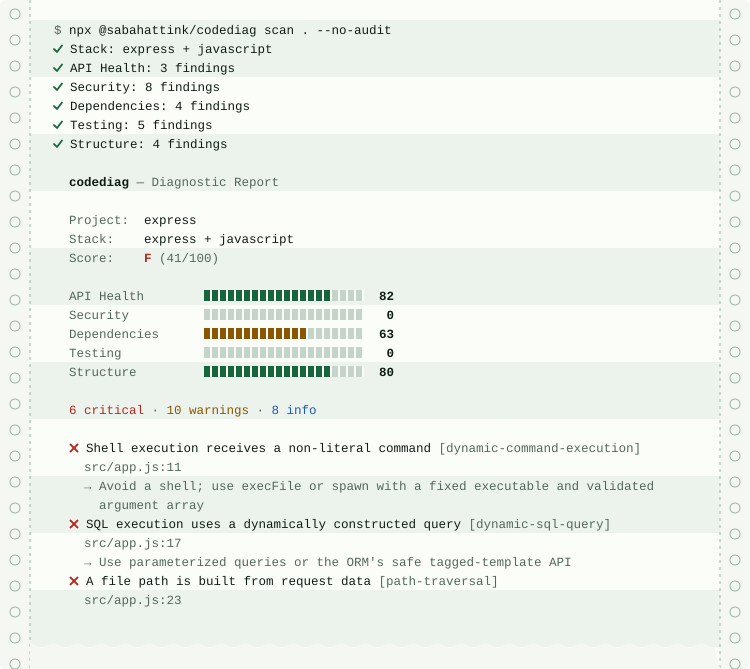

<p align="center">
  
</p>

<h1 align="center">codediag</h1>

<p align="center">
  <strong>Diagnose your code before you ship.</strong><br>
  <sub>One command. Five analyzers. One score.</sub>
</p>

<p align="center">
  <a href="https://www.npmjs.com/package/codediag"></a>
  <a href="https://www.npmjs.com/package/codediag"></a>
  <a href="https://github.com/scuton-technology/codediag/actions"></a>
  <a href="https://github.com/scuton-technology/codediag/blob/main/LICENSE"></a>
</p>

<br>

<p align="center">
  
</p>

<br>

## Install

```bash
npx codediag scan .
```

That's it. No config. No account. No server.

Or install globally:

```bash
npm install -g codediag
```

## What it checks

codediag auto-detects your stack and runs 5 analyzers:

### API Health `NestJS` `Express` `Next.js`

Discovers endpoints with real AST analysis (ts-morph, not regex) and checks that state-changing routes are authenticated and that request bodies are validated.

- **NestJS**: `@Get`, `@Post`, `@Put`, `@Delete`, `@Patch` handlers. Checks auth guards (`@UseGuards`, or a global `APP_GUARD` / `useGlobalGuards`), typed DTOs (an `any` body does not count), Swagger docs, and return types.
- **Express**: `app.get()`, `router.post()`, `router.route()` and friends, including routers mounted from other files with `app.use("/prefix", router)` (ES modules and CommonJS). Checks auth middleware (on the route, `router.use(auth)` registered before it, or at mount time), body validation (express-validator, celebrate, zod/joi/yup middleware or `schema.parse(req.body)` in the handler), and, on Express 4 without `express-async-errors`, async handlers that leave rejected promises unhandled.
- **Next.js**: App Router `app/**/route.ts` exported `GET`/`POST`/... handlers and Pages Router `pages/api/**` handlers. Checks session checks in the handler (`auth()`, `getServerSession()`, ...), auth wrappers (`withAuth(handler)`), or coverage by an auth `middleware.ts` / `proxy.ts` `matcher`, plus schema validation of `request.json()` / `req.body`.

Routes that are public by design (`/login`, `/register`, `/auth/*`, `/webhooks/*`, `/health`, ...) and NestJS handlers marked `@Public()` are not reported as missing auth. If no routes are found (for example a Next.js app without API routes), API Health is skipped rather than scored 0. Detection is heuristic: dynamically registered routes and Next.js Server Actions are not analyzed.

### Security

Scans every source file for hardcoded secrets (API keys, passwords, Stripe keys, AWS credentials, GitHub tokens) with file and line, skipping obvious placeholders, and validates `.gitignore`. For web frameworks it also checks helmet middleware and CORS configuration (NestJS, Express), and rate limiting and password hashing (NestJS, Express, Next.js).

### Dependencies

Runs `npm audit`, checks lock file existence, flags deprecated packages, validates engine specs and essential npm scripts. `npm audit` needs network access and a `package-lock.json`; when it cannot run, the check gets half credit and an info issue explains why.

### Testing

Detects test files and frameworks (Jest, Vitest, Mocha, Ava), calculates test-to-source ratio, checks for e2e directories and coverage configuration.

### Structure

Validates README quality, linter/formatter config, TypeScript strict mode (following `extends`), a source directory, NestJS module organization (NestJS only), and `.env.example` presence.

## Scoring

Each analyzer scores 0-100. Weighted average determines the grade:

```
API Health: 25%  ·  Security: 30%  ·  Dependencies: 20%  ·  Testing: 15%  ·  Structure: 10%
```

| A+ | A | B+ | B | C | D | F |
|:--:|:-:|:--:|:-:|:-:|:-:|:-:|
| 95+ | 90+ | 85+ | 80+ | 70+ | 60+ | <60 |

Analyzers that are disabled or skipped are left out and the remaining weights are re-normalized.

## CLI

```bash
codediag scan .                    # Full report
codediag scan . --format json      # JSON (for CI/CD)
codediag scan . --format md        # Markdown (for PRs)
codediag scan . --ci               # JSON + exit code
codediag scan . --threshold 80     # Fail below 80
codediag scan . --quiet            # Score only
codediag scan . --verbose          # All issues
codediag init                      # Create .codediag.yml
```

Exit codes, in every output mode:

| Code | Meaning |
|:----:|---------|
| 0 | Score is at or above the threshold |
| 1 | Score is below the threshold (`--threshold`, else `threshold` in `.codediag.yml`, else 70) |
| 2 | Invalid flag or config file, or the scan failed |

With `--format json`, `--format md` and `--ci`, stdout contains only the report, so it can be piped (`codediag scan . --ci > report.json`). Progress and errors go to stderr; the spinner is shown only in an interactive terminal.

## CI/CD

```yaml
# GitHub Actions
- run: npx codediag scan . --ci --threshold 80
```

```yaml
# GitLab CI
codediag:
  script: npx codediag scan . --ci --threshold 80
```

```bash
# Pre-push hook (husky)
npx codediag scan . --quiet --threshold 70
```

## Config

Optional. Create `.codediag.yml` (or `.codediag.yaml`) in the scanned directory, or run `codediag init`:

```yaml
threshold: 70            # integer 0-100; --threshold overrides it
ignore:                  # added to the built-in node_modules, dist, .git, coverage
  - test/fixtures        # contains "/": relative to the project root
  - vendor               # bare name: matches at any depth
  - "**/*.generated.ts"  # globs are supported
analyzers:               # set any to false to skip it
  api: true
  security: true
  dependencies: true
  testing: true
  structure: true
```

`ignore` applies to every analyzer that walks files. Unknown keys, wrong types and malformed YAML are rejected with a message that lists every problem, and the scan exits with code 2.

## Supported stacks

| Stack | API Health | Security | Deps | Testing | Structure |
|-------|:---------:|:--------:|:----:|:-------:|:---------:|
| NestJS | ✅ | ✅ | ✅ | ✅ | ✅ |
| Next.js | ✅ | ✅ | ✅ | ✅ | ✅ |
| Express | ✅ | ✅ | ✅ | ✅ | ✅ |
| Node.js | — | ✅ | ✅ | ✅ | ✅ |

## How it compares

| | codediag | SonarQube | Snyk | ESLint |
|---|:---:|:---:|:---:|:---:|
| Zero config | ✅ | ❌ | ❌ | ❌ |
| NestJS-aware | ✅ | ❌ | ❌ | ❌ |
| Security scan | ✅ | ✅ | ✅ | ❌ |
| Dep audit | ✅ | ❌ | ✅ | ❌ |
| Test check | ✅ | ✅ | ❌ | ❌ |
| Unified score | ✅ | ✅ | ❌ | ❌ |
| Offline | ✅ | ❌ | ❌ | ✅ |
| Free | ✅ | Partial | Partial | ✅ |

## Roadmap

- [x] NestJS API health analyzer
- [x] Security scanner
- [x] Dependency auditor
- [x] Test coverage analyzer
- [x] Project structure analyzer
- [x] Next.js API health analyzer
- [x] Express API health analyzer
- [ ] SVG badge generator
- [ ] GitHub Action
- [ ] Web dashboard
- [ ] AI-powered fixes
- [ ] VS Code extension

## Contributing

```bash
git clone https://github.com/scuton-technology/codediag.git
cd codediag && npm install && npm run build
npm test                     # vitest (Node 20+)
node dist/index.js scan /path/to/project
```

Use [conventional commits](https://www.conventionalcommits.org/): `feat:`, `fix:`, `docs:`, `refactor:`

## License

MIT — [Scuton Technology](https://scuton.com)

<br>

<p align="center">
  <sub>If codediag caught something before your users did, give it a ⭐</sub>
</p>
